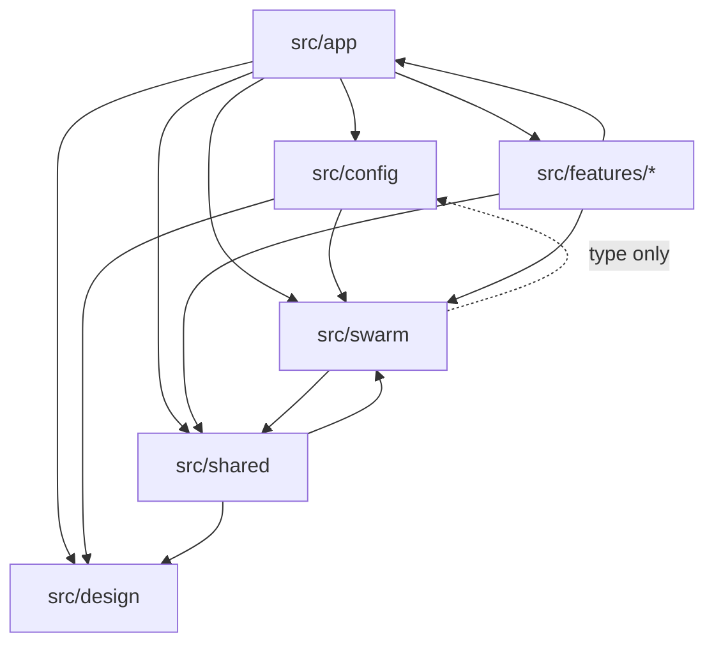
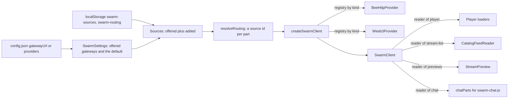

# Architecture

## The folders and what each owns

```
.github/workflows/  ci.yml on every pull request and push to main, image.yml on a v* tag
deploy/nginx/       the image's server config and the start script that writes the policy from its settings
docs/               this documentation
e2e/                the Playwright suites, their fakes, the recorder and the recorded Bee answers
public/             config.json (the example with placeholders), favicon, manifest.json, robots.txt
scripts/            build-label.mjs, first-load-size.mjs, unused-exports.mjs and its baseline, weeb3-files.mjs
src/
  app/              the entry, routes, the app provider and context, theme choice, browser storage, the page layout
  config/           runtimeConfig.ts: the config.json schema, loader and helpers
  design/           tokens, themes (look and content), fonts, logos, the look applier
  features/
    catalog/        the stream list: feed reader, polling, cards, previews, search, paging, the watch-page view logic
    player/         the HLS-over-Swarm player, its loaders, followers and overlays, the watch page
    chat/           the chat panel, guest and Swarm ID sign-in, who pays, verification, ENS, the chat library's lifecycle
    connect/        My Swarm, the panel the header opens: ID, chat stamp, sources, Use for, adding, settings, failure bars
    gateway/        a source's checks, its light status, the address rules, the diagnostics report, node-in-tab status
  shared/           modules copied from streaming-monorepo (stream list format, feed following, markers, playlists),
                    the gateway clock, request jitter, the build label, and components more than one feature uses
  swarm/            the Swarm client: providers, kinds, registry, answers, settings, sources, routing. No React
test/               the vitest suites, by feature in subfolders, with helpers/ and the feedModel/ simulator
Dockerfile          the image: node builds dist/, nginx serves it
vite.config.js      the build: base './', the @ alias, the /bee proxy, the build label, the weeb-3 files plugin
vitest.config.ts    node environment, 30 s backstop timeout
```

`src/features/gateway` is named for what it checks, not for a UI it owns, and it does hold three small components
(`StatusDot`, `HelpSteps`, `NodeInTabProgress`) that My Swarm and the watch page draw.

## The import direction, and the boundary test



Two rules hold, and one test enforces them, `test/swarm/boundary.test.ts`:

1. **`src/swarm` imports nothing from `src/app` or `src/features`.** It may import `src/shared` (feed following, the
   gateway clock) and the `RuntimeConfig` type from `src/config`.
2. **The app and the features reach Swarm only through the client.** No line in `src/app` or `src/features` may build
   a Bee URL, call `fetch`, make a Bee client, or load a URL with `XMLHttpRequest` or `new Image(`. They may import
   from `src/swarm` only its public surface, `client`, `answers`, `provider`, `settings`, `createSwarmClient`,
   `addressSpace`, `sources` and `routing`, plus seven named exceptions for the chat's writes and the single-owner
   chunk codec, each with its reason in the test.

The features import each other and `src/app` freely (catalog and player, chat and connect), and no test forbids that.
`test/noUnboundedFetch.test.ts` adds that no file under `src/` calls the global `fetch` unbounded.

## The app shell

`index.html` loads `src/app/App.tsx`. Before the config loads, the theme a returning viewer picked is read from
`localStorage` and worn (`themeChoice.ts`, `applyLook`), so the page never flashes the default look. Then
`loadRuntimeConfig()` runs. On a problem the page renders `ConfigProblem` with the field and the reason and nothing
else. On success it applies the theme's content and look and renders, inside `StrictMode`, this nesting, outer to
inner:

| Provider              | File                                      | Holds                                                                                             |
| --------------------- | ----------------------------------------- | ------------------------------------------------------------------------------------------------- |
| `AppContextProvider`  | `src/app/AppProvider.tsx`                 | The stream list, the Swarm client, the sources, the routing, the chat config, the theme's content |
| `ThemeChoiceProvider` | `src/app/ThemeChoiceProvider.tsx`         | The look the viewer picked and the switcher                                                       |
| `AppChatUserProvider` | `src/app/AppChatUserProvider.tsx`         | Wraps `ChatUserProvider` (`src/features/chat/User.tsx`): guest and Swarm ID sessions              |
| `ConnectProvider`     | `src/features/connect/ConnectContext.tsx` | Whether My Swarm is open and which view it shows                                                  |
| `ChatStampProvider`   | `src/features/chat/stamp/ChatStamp.tsx`   | Who pays, the site's stamp and its figures, the own-stamp sender                                  |
| `EnsNamesProvider`    | `src/features/chat/ens/EnsNames.tsx`      | ENS lookups and their cache                                                                       |
| `HashRouter`          | react-router                              | URLs are `#/...`, so a static host needs no rewrite for a deep link                               |
| `BaseRouter`          | `src/app/routes.tsx`                      | The routes, inside `MainLayout`                                                                   |

The routes are `/` (the stream list, `StreamBrowser`) and `/watch/:mediatype/:owner/:topic` (the watch page,
`StreamWatcher`), anything else `NotAStreamPage`. A watch URL is therefore `#/watch/<mediatype>/<owner>/<topic>`, with
`?qoe=1` for the playback quality panel and `?level=<quality>` to pin one quality. `MainLayout`
(`src/app/layout/MainLayout.tsx`) is the header with the theme's logo and the My Swarm button, the failure bars, and
`<main>`, with the `Footer` beside it.

## Runtime config

`src/config/runtimeConfig.ts` fetches `./config.json` with `cache: 'no-store'` and parses it with a zod schema. It
never throws: the result is `{ok: true, config}` or `{ok: false, problem}`. The schema refuses placeholders still in
`<angle brackets>`, requires exactly one of `gatewayUrl` and `providers`, requires every chat field when `chat.enabled`
is true, and allows only `bee-http` as a gateway kind. `chat.beeUrl` is refused by name, with a message that
`chat.readUrl` and `chat.writeUrl` replace it. Unknown keys are dropped.
Helpers (`selectedTheme`, `themeSwitcherEnabled`, `enabledChat`, `swarmIdUrl`, `ensRpcUrl`) answer the questions the
rest of the app asks, so no component reads the raw config. The fields are listed in
[configuration](../configuration.md).

## The Swarm client



- **A provider** (`src/swarm/provider.ts`) is one way of reaching Swarm. It answers six reads, gives URLs for what the
  browser loads itself, reports its status, can be probed, and starts and stops. Every read resolves to a
  `SwarmAnswer` (`answers.ts`) and never rejects.
- **A kind** (`providerKinds.ts`, `registry.ts`) is the code behind a provider: `bee-http` and `weeb-3`. A deployment
  may offer only `bee-http` gateways in its config.
- **A source** (`sources.ts`) is what the viewer sees in My Swarm: the offered gateways, always of type `gateway`, and
  the sources they added, of type `gateway`, `bee-node` or `weeb-3`. Both `gateway` and `bee-node` are read through
  `bee-http`.
- **Routing** (`routing.ts`) maps the four [parts](stack.md#words-used-across-these-docs), `player`, `stream-list`,
  `previews` and `chat`, to source ids, in `one` mode all to one source, in `per-part` mode each to its own. An id
  that names no known source resolves to the default gateway.
- **The client** (`client.ts`, made by `createSwarmClient.ts`) holds one provider for the player's source and a route
  per part that differs. `reader(part)` gives a part its reader. It counts every answer, keeps the gateway clock from
  the player's and the stream list's answers, records each part's failures for the failure bars, and gives a read at
  least the provider's `shortestReadWindowMs`.

`AppProvider` builds the client from the settings and the saved choices, and rebuilds it only when a part's source id
or address changes (`clientKey`). On a rebuild it hands the player's new reader to the shared `ManifestFetcher`, resets
the stream list reader when the list's source changed, and marks every playlist dirty. The chat's route is the source
picked for Chat history, except that the deployment's default gateway reads the chat at `chat.readUrl`
(`chatHistorySettingOf`). The full detail is in [the Swarm client](../swarm-client.md) and
[extending the providers](../extending-providers.md).

## State and browser storage

State lives in React context and hooks, with no store library:

- `AppContextProvider` holds the stream list (`{streams, gateway, slot}`, the slot being the feed entry it was read
  from), whether it has loaded and from which source, the Swarm client, the sources, the routing and the resolved
  parts, and the functions that add, rename and remove a source and set the routing. The stream list is polled with
  SWR (`useCatalogPoll`).
- `ChatUserProvider` holds the guest session and the Swarm ID session, `ChatStampProvider` holds who pays and the
  stamp, `EnsNamesProvider` the names, `ConnectProvider` the panel's view, `ThemeChoiceProvider` the look.
- The player keeps its playlists in two module singletons, `ManifestStateManager` and `ManifestFetcher`
  (`src/features/player/ManifestManagement.ts`, `CustomManifestLoader.ts`), because hls.js's loaders are classes it
  constructs itself.

Everything kept across reloads is in `localStorage`, every access guarded in `src/app/browserStorage.ts` so a refusal
leaves the defaults for that visit. The keys are `swarm-sources`, `swarm-routing`, `viewer-theme`,
`stream-event-client:chat-session`, `stream-event-client:chat-stamp:<address>`,
`stream-event-client:own-player-quality` and `stream-event-client:qoe-panel.v1`, described in
[My Swarm](../my-swarm.md#what-the-browser-keeps). The Swarm ID sign-in is kept by the Swarm ID library in its own
frame, never by the page.
