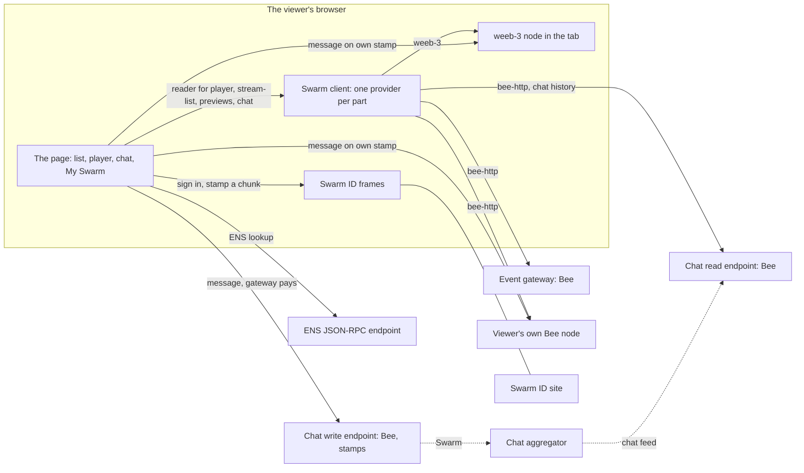

# Overview

## The app in a nutshell

stream-event-client is a static web page for watching an event's live streams and recordings over
[Swarm](https://www.ethswarm.org), the decentralised storage network, with a chat beside each stream. It is built with
React 19, Vite 8 and TypeScript, plays video with hls.js, and reads everything it shows from Swarm through a small
client layer of its own. It holds no keys, no stamps and no accounts: what it needs to pay for or sign is done by
services outside it, or by Swarm ID in the viewer's browser.

It was built from the viewer of [streaming-monorepo](https://github.com/Solar-Punk-Ltd/streaming-monorepo) and the
Swarm design and chat of [msrs-client](https://github.com/Solar-Punk-Ltd/msrs-client). Some files in `src/shared`
still name the path and commit they were copied from.

## What a viewer does

1. Opens the page and sees the stream list: live streams featured, the next upcoming one with a countdown, the other
   upcoming ones, then past streams, with search and paging.
2. Opens a stream. The watch page plays it at one quality at a time, following the playlist feed of that quality on
   Swarm, and shows the chat beside the video.
3. Chats, as a guest with a display name or signed in with Swarm ID, with the event gateway paying for each message
   or, once signed in, a stamp of their own.
4. Opens My Swarm, the panel behind the header button, to see or change where each part of the page reads from: the
   event's gateway, another gateway, a Bee node of their own, or Weeb3, a Swarm node that runs inside the browser tab.
   Nothing ever switches source by itself.

## What runs where

| Piece                             | Where it runs                                | What it does                                                                                                                                   |
| --------------------------------- | -------------------------------------------- | ---------------------------------------------------------------------------------------------------------------------------------------------- |
| The page                          | The viewer's browser, served as static files | Everything in this repository: the list, the player, the chat, My Swarm                                                                        |
| `config.json`                     | Served beside the page, never cached         | Every setting a deployment differs by: the gateway, the stream list feed, the chat, Swarm ID, the theme ([configuration](../configuration.md)) |
| The event gateway                 | A Bee node run by the event                  | Serves the stream list feed, the playlists, the segments and the pictures. Proxied at `/bee` by the image, or read at its own address          |
| The chat read and write endpoints | Two Bee nodes run by the event               | One serves the chat feed and history files, the other stamps and takes each message ([the chat](../chat.md))                                   |
| The chat aggregator               | A service run by the event                   | Listens on the shared chat address and appends each message to the stream's chat feed. Not in this repository                                  |
| Swarm ID                          | A separate site, framed by the page          | Holds the viewer's accounts, gives the page a chat key and a binding, stamps a message on the viewer's own stamp ([Swarm ID](../swarm-id.md))  |
| An ENS endpoint                   | An Ethereum JSON-RPC service, optional       | Resolves a sender's wallet to an ENS name                                                                                                      |
| A Bee node of the viewer's        | The viewer's own machine or server           | Any part may read from it instead of the gateway, and it can send a message on the viewer's own stamp                                          |
| weeb-3                            | Inside the browser tab, as WebAssembly       | A whole Swarm node, with a service worker and a shared worker, that any part may read from ([weeb-3](../weeb3.md))                             |
| The image                         | nginx in a container                         | Serves the page, proxies `/bee`, writes the content security policy from its settings ([the image](../image.md))                               |

## How a request flows

Every read of Swarm content goes through the client (`src/swarm/`), which hands each part of the page, the player, the
stream list, the previews and the chat history, to the provider the viewer picked for it. The three writes the page
makes are the exceptions and are named as such in the boundary test: a chat message to the event's write endpoint, and
a message on the viewer's own stamp to their Bee node or to weeb-3. Segments and pictures are loaded by hls.js and the
browser from URLs the provider gives, and each load's outcome is reported back to the client.

## Where to look first

- The entry and the provider nesting: `src/app/App.tsx`.
- Where a part's source is chosen and the client rebuilt: `src/app/AppProvider.tsx`.
- The provider interface: `src/swarm/provider.ts`.
- The watch page: `src/features/player/StreamWatcher/StreamWatcher.tsx`.
- The chat's lifecycle: `src/features/chat/useSwarmChat.ts`.
- My Swarm: `src/features/connect/Connect.tsx`.
