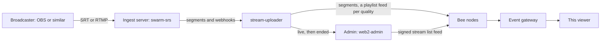
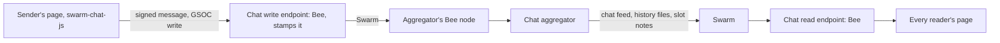

# The whole stack

This viewer is one piece of a larger system. Other repositories put the streams on Swarm, run the chat, and hold the
viewer's identity. This page names each piece and its repository, then follows a live stream and a chat message from
start to finish, so a newcomer can see where any part of the work lives. A short glossary of the Swarm words used
across these docs closes the page.

## The pieces and their repositories

| Piece               | Repository                                                                                                         | What it is                                                                                                                                      | How this viewer meets it                                                                           |
| ------------------- | ------------------------------------------------------------------------------------------------------------------ | ----------------------------------------------------------------------------------------------------------------------------------------------- | -------------------------------------------------------------------------------------------------- |
| The viewer          | [Solar-Punk-Ltd/stream-event-client](https://github.com/Solar-Punk-Ltd/stream-event-client)                        | This repository: the stream list, the player, the chat and My Swarm, as a static page                                                           |                                                                                                    |
| The streaming stack | [Solar-Punk-Ltd/streaming-monorepo](https://github.com/Solar-Punk-Ltd/streaming-monorepo), `apps/hls-stream`       | Takes a broadcast in, cuts it into HLS segments, and writes the segments and each quality's playlist feed to Swarm (`packages/stream-uploader`) | The player reads the playlists and segments it wrote                                               |
| The admin           | streaming-monorepo, `apps/web2-admin`                                                                              | The console where an event's streams are declared and published. It signs the stream list feed                                                  | The browse page reads that stream list                                                             |
| The infra manager   | streaming-monorepo, `apps/infra-manager`                                                                           | Tools to set up and run the streaming stages                                                                                                    | Nothing directly                                                                                   |
| The ingest server   | [Solar-Punk-Ltd/swarm-srs](https://github.com/Solar-Punk-Ltd/swarm-srs)                                            | A fork of the SRS media server. It takes SRT or RTMP from the broadcaster, cuts HLS and tells the uploader about each segment                   | Nothing directly                                                                                   |
| The chat library    | [Solar-Punk-Ltd/swarm-chat-js](https://github.com/Solar-Punk-Ltd/swarm-chat-js), npm `@solarpunkltd/swarm-chat-js` | Signs and sends chat messages, and reads a chat back                                                                                            | The chat runs on it ([the chat](../chat.md))                                                       |
| The chat aggregator | [Solar-Punk-Ltd/swarm-chat-aggregator-js](https://github.com/Solar-Punk-Ltd/swarm-chat-aggregator-js)              | The chat server. It listens for new messages, checks each one, and publishes it to the stream's chat feed                                       | The chat reads the feed it writes                                                                  |
| Swarm ID            | [Solar-Punk-Ltd/solarpunk-id](https://github.com/Solar-Punk-Ltd/solarpunk-id), npm `@solarpunkltd/swarm-id`        | Solar Punk's fork of swarm-id: a site that holds a person's accounts, and the library apps use to sign in with it                               | Sign in with Swarm ID and My stamp ([Swarm ID](../swarm-id.md))                                    |
| weeb-3              | [lat-murmeldjur/weeb-3](https://github.com/lat-murmeldjur/weeb-3), npm `@lat-murmeldjur/weeb_3`                    | A whole Swarm node compiled to WebAssembly that runs inside a browser tab                                                                       | Weeb3 in My Swarm, for the video and for sending on the viewer's own stamp ([weeb-3](../weeb3.md)) |
| Bee                 | [ethersphere/bee](https://github.com/ethersphere/bee)                                                              | The Swarm node every other piece talks to                                                                                                       | Every gateway and Bee node the viewer reads from is one                                            |

Two more repositories matter as history:

- [msrs-client](https://github.com/Solar-Punk-Ltd/msrs-client) is the older client whose Swarm design and chat this viewer was built from. It is no longer developed.
- [swarm-hls-stream](https://github.com/Solar-Punk-Ltd/swarm-hls-stream) is where the streaming stack lived before it moved into streaming-monorepo. It takes no new changes.

The event's own servers are set up from a private infrastructure repository, which is why no host, address, key or
stamp appears in these public docs.

## A live stream, from the broadcaster to the screen

1. **The stream is declared.** Someone creates the stream in the admin and publishes it. A stream that was not
   published is refused by its stage when the broadcast starts.
2. **The broadcast comes in.** The broadcaster sends SRT or RTMP to the ingest server, which cuts the video into HLS
   segments, a few seconds each, at several qualities, the ladder.
3. **The segments go to Swarm.** The stream uploader stores each segment on Swarm through a Bee node, and after each one
   updates that quality's playlist, which lives at a feed of its own. It also writes markers the viewer uses to find
   the newest entry without searching for it. When the broadcast ends, each playlist is closed as a recording.
4. **The stream list says it is live.** The uploader tells the admin the stream is live, and later that it ended. The
   admin then writes the event's stream list feed and signs it with the event's key.
5. **The viewer plays it.** The browse page reads the stream list once a minute. The watch page reads the playlist
   feed of the one quality it plays and loads the segments it names, from the source My Swarm picked, by default the
   event gateway ([the player](../player.md)).

## A chat message, from sending to every reader's screen

1. **The message is signed.** The sender's page signs it with their chat key: a key this browser made for a guest, or
   the key Swarm ID gives this site for a signed-in person, with the binding that proves it is theirs.
2. **It is written to the shared inbox.** Every chat of the event writes to one shared address, a GSOC. While the
   event pays, the page writes it through the chat write endpoint, a Bee node that stamps it. On the viewer's own
   stamp, Swarm ID stamps it and the page sends it through the viewer's Bee node or weeb-3
   ([who pays](../own-stamp.md)). A message not seen back in the chat is written again, a few times.
3. **The aggregator picks it up.** Its own Bee node hears every new write to the inbox. The write endpoint must be a
   different Bee node, because Bee hands a write on to a listener only when it came from another node. The aggregator
   checks the message's size, shape, signature, binding, clock and rate, drops a copy it already has, and publishes it
   as the next entry of the stream's chat feed, `chat-<stream topic>` under the aggregator's own key.
4. **Readers see it.** Each reader's page reads the chat through the chat read endpoint. Besides each entry, the
   aggregator saves a history file and writes short notes per time slot saying which entries landed, so a reader asks
   only for entries that exist ([the chat](../chat.md)).

## Words used across these docs

- **Bee**: the program that runs a Swarm node.
- **Gateway**: a Bee node others can read through over HTTPS. The event runs its own, the event gateway.
- **Chunk**: the unit Swarm stores, up to 4 KB. A segment or a file is a tree of chunks, named by the address of its
  root.
- **Postage stamp, batch**: what pays for storing chunks. A batch is bought once and stamps chunks until it is full or
  runs out of time. The viewer never holds one.
- **Feed**: an address that always points at the newest version of something, made from an owner, the key that signs
  it, and a topic, a name. Its entries are numbered, so an older entry can be read by its index. The stream list, each
  playlist and each chat are feeds.
- **Single-owner chunk (SOC)**: a chunk only its owner's key can write. A feed entry is one.
- **GSOC**: a single-owner chunk whose key is shared on purpose, so anyone can write to it and a listener hears each
  write. The chat inbox is one, which is why its key in `config.json` is not a secret ([the chat](../chat.md)).
- **HLS, ladder, rung**: HLS is video cut into short segments listed by a playlist. The ladder is the set of qualities
  a stream is cut at, and a rung is one of them.
- **Master playlist**: the playlist that lists every rung. When the stream list names the rungs, the viewer builds it
  itself.
- **Marker, slot note**: small entries the writers add so a reader can find the newest entry of a feed by its number
  instead of searching. The uploader writes markers for playlists, the aggregator writes slot notes for the chat.
- **Swarm ID binding**: a person's signed statement that a chat key on one site belongs to their account.
- **weeb-3, Weeb3**: the Swarm node in the browser tab. The package is weeb-3, and My Swarm calls the source Weeb3.
